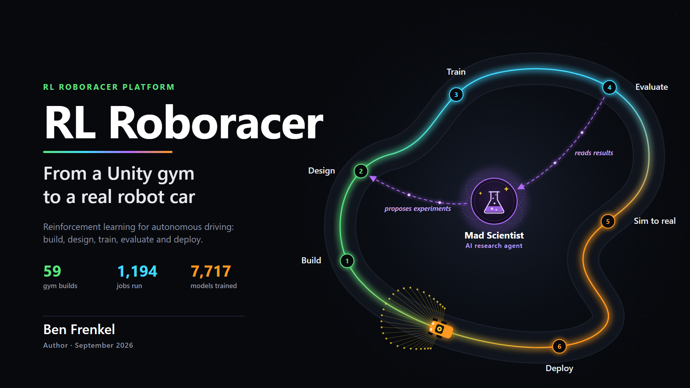
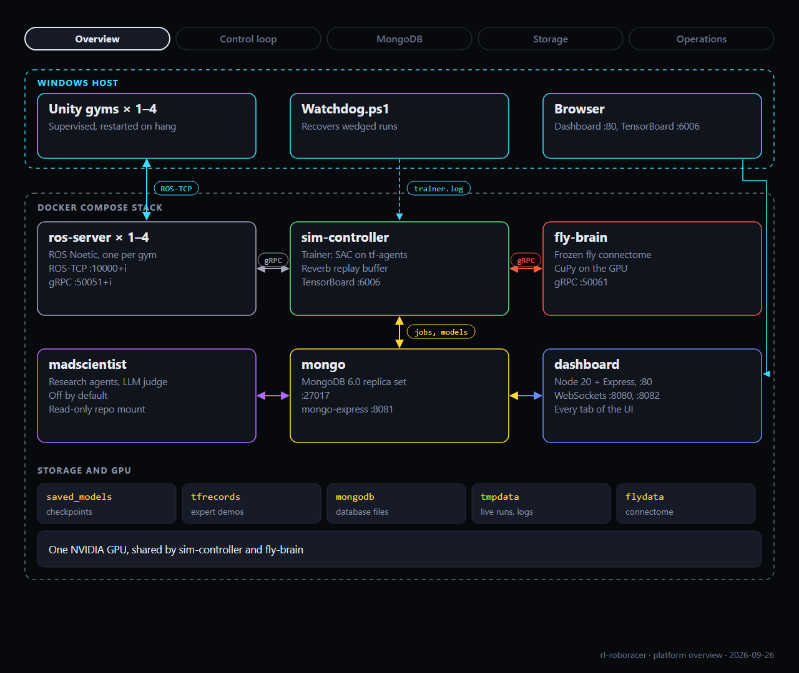

# RL Roboracer

**A reinforcement learning platform for autonomous driving: from a Unity gym to a real 1/10-scale robot car.**

Build a simulated track, design rewards and experiments, train Soft Actor-Critic policies across parallel simulators, evaluate and diagnose them, and carry the best one toward a Waveshare JetRacer, with an AI research agent proposing the next experiment.



## Highlights

- **Demonstration-guided RL.** Soft Actor-Critic with advantage-weighted (AWAC) actor regularization, a demo-protected replay buffer and a performance-gated track curriculum, trained across up to four parallel simulators. See [training](docs/training.md).
- **Real to sim with Gemini.** A phone video walking around the physical track goes to Gemini (`gemini-4-argon`), which returns a measured top-down layout. That becomes a Blender model and then a Unity gym of the real track ([`scripts/real2sim/`](scripts/real2sim/)).
- **Sim to real by design.** The `donut_no_hint` policy sees only what the real car can measure (speed, sideslip, 29 lidar-like rays), and the simulator mirrors the JetRacer's body, camera and intrinsics. See [sim2real](docs/sim2real.md) and the [deployment plan](docs/jetracer-deployment-plan.md).
- **An experiment platform, not a script.** A web dashboard for the job queue, reward designs written as versioned code, experiment designs, a leaderboard, statistical model comparison and a track **weakness map** that shows where a policy crashes. Everything is stored in MongoDB. See the [dashboard notes](docs/dashboard.md).
- **Agentic research tooling.** The [Mad Scientist](docs/madscientist.md) reads arXiv and the codebase, drafts experiment proposals, has an LLM judge score them against a rubric, and queues the approved ones. An [MCP server](mcp/console/) exposes the whole console to coding agents, and [agent skills](.cursor/skills/) encode workflows such as diagnosing a run or measuring the sim-to-real observation gap.
- **A fruit fly connectome at the wheel.** As an experiment, a frozen 166,700-neuron *Drosophila* connectome drives the car through a fitted linear readout: about 7× a random policy and a tenth of SAC. See [fly brain](docs/fly-brain.md).
- **One-command install** on Windows, with an installer that diagnoses its own failures ([InstallZero](#quickstart)).

## Results

Average evaluation return of different drivers on the `donut_no_hint` course ([fly brain](docs/fly-brain.md)):

| Policy | Average return |
|---|---|
| Random | ~1.0 |
| Frozen fly connectome + ridge readout | 6.87 |
| SAC (`7573_step_87314`) | 75.7 |

## How it fits together



Unity simulators run on the Windows host, one to four in parallel. Each talks ROS-TCP to its own ROS Noetic bridge container, which the TensorFlow / tf-agents trainer reaches over gRPC. Jobs, models, designs and per-step driving logs live in MongoDB; the dashboard and the Mad Scientist work entirely through it. The [platform overview](docs/images/readme-platform-overview.png) shows the full user journey.

## Quickstart

**Requirements:** Windows 10 or 11, an NVIDIA GPU with a current driver, about 60 GB free disk, and 30-60 minutes for the first build. Linux and macOS are not supported yet.

In PowerShell (not as administrator):

```powershell
irm https://raw.githubusercontent.com/frenb/rl-roboracer/main/install.ps1 | iex
```

The installer sets up WSL 2, Git and Docker Desktop if they are missing, clones the repo to `%USERPROFILE%\rl-roboracer`, builds the Docker images, downloads the prebuilt Unity gyms and expert demonstrations from the [v0.1 release](https://github.com/frenb/rl-roboracer/releases/tag/v0.1), starts the stack and a Unity client, and queues a short first training job. It may ask for a restart and then continues by itself. If a step fails it matches the failure against a catalog of known problems and, optionally, asks an LLM of your choice to diagnose it.

When it finishes:

- Dashboard: http://localhost
- TensorBoard: http://localhost:6006

More:

- Options: run with `-DryRun` to see what would change; `-Doctor` picks the diagnosing model. Full list: `Get-Help $env:LOCALAPPDATA\rl-roboracer-install\Install.ps1 -Detailed`.
- Uninstall: `irm https://raw.githubusercontent.com/frenb/rl-roboracer/main/uninstall.ps1 | iex` (asks before removing anything).
- Manual developer setup: [docs/setup.md](docs/setup.md). With the InstallZero CLI, `installzero install` at the repo root follows [install.md](install.md).
- Day-to-day start, stop and multi-actor runs: [docs/operations.md](docs/operations.md).

**No Windows GPU machine?** The [platform overview](docs/images/readme-platform-overview.png) and the [docs](docs/README.md) cover the system without running it.

## Repository layout

```
rl-roboracer/
├── rl_agent/          trainer: tf-agents SAC/AWAC, courses, curriculum, Mad Scientist, fly-brain client
├── dashboard/         Node/Express web console (jobs, models, designs, analysis, weakness map)
├── unity/             Unity 2020.3 simulator project (original)
├── unity6.6/          Unity 6.6 port of the simulator; newest gyms are built from it
├── docker/            images: ROS bridge, trainer, fly brain, Mad Scientist
├── protos/            gRPC contracts between the trainer, ROS bridge and fly brain
├── mcp/console/       MCP server exposing the console to coding agents
├── scripts/           stack lifecycle, installer, Unity build and real2sim pipeline
├── docs/              guides, design notes and the preprint (index: docs/README.md)
└── .cursor/skills/    agent skills: run diagnosis, sim-real gap, JetRacer deployment
```

## Status

Built and in daily use: the simulator, the parallel trainer, the dashboard, the curriculum, AWAC, the real-to-sim pipeline, the fly-brain driver and the installer. Experimental: camera-observation courses (`donut_camera`), which train in simulation from the simulated CSI camera ([notes](docs/camera-demo-tfrecord-plan.md)), and the Mad Scientist, which is off by default. Planned and not yet built: running a policy on the physical JetRacer ([plan](docs/jetracer-deployment-plan.md)).

## License

MIT, see [LICENSE](LICENSE). Some Unity assets are under their own licenses; see [THIRD_PARTY_NOTICES.md](THIRD_PARTY_NOTICES.md).

Built by Ben Frenkel.
