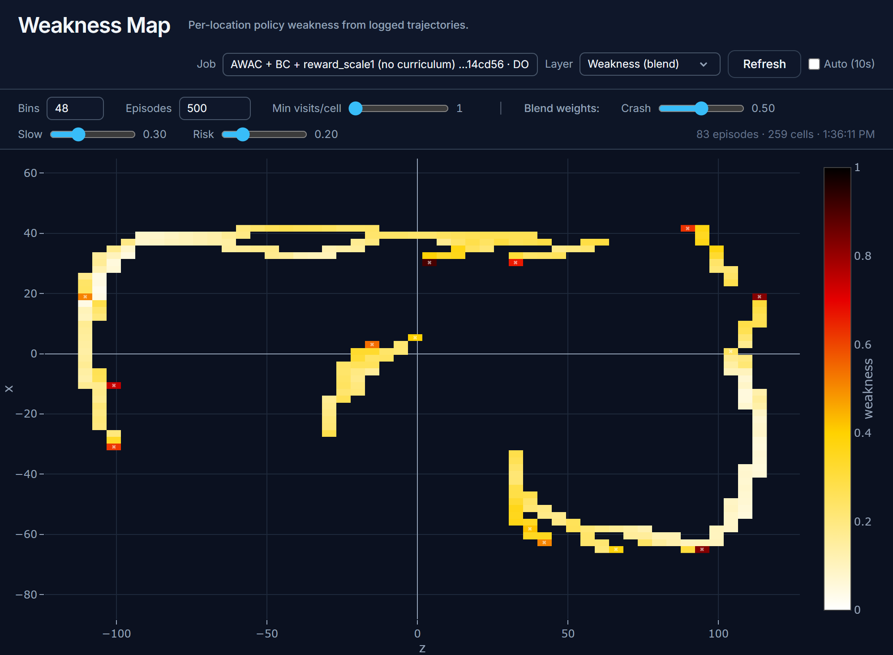

# Dashboard: architecture notes and limitations

The dashboard is an Express + static-HTML app (`dashboard/`, compose service
`dashboard` on **`node:20`**, `npm start` → `node ./build/index.js`). Pages are
static HTML with inline JS (edits are live on browser reload); only `server.ts`
changes need a **dashboard container restart** to recompile. `prestart` runs
`npm install` **only when `node_modules` is missing**, then always `tsc` — so a
restart is a fast offline compile rather than a network-dependent reinstall
(after bumping the base image, do a one-time `rm -rf node_modules && npm install`
so ABI-sensitive deps rebuild).

A few architectural points are worth knowing:

- **Crash resilience.** The server installs process-level `uncaughtException` /
  `unhandledRejection` guards, and every Mongo request handler responds with a
  `500` instead of `throw err`. Historically a single transient Mongo error (a
  change-stream reconnect, replica-set blip, connection reset) threw inside an
  async driver callback → on Node ≥15 an unhandled rejection **terminated the
  process**; `restart: always` then bounced the container through a full
  `npm install` + `tsc` before serving again — the classic "dashboard freezes /
  locks up mid-demo". Errors are now logged and swallowed so one bad query can't
  take the whole UI down. The startup `MongoClient.connect` retries with backoff
  instead of throwing (no boot crash-loop if mongo lags the dashboard).
- **Change-gated GETs (per-client version cursor).** List endpoints
  (`/get_jobs`, `/get_models`, `/get_experiment_designs`, …) are gated by
  `needsUpdate(req, res, changed, coll)`. A MongoDB **change stream**
  (`superviseChangeStream`, requires Mongo be a replica set) bumps a
  monotonically-increasing **per-collection version** on every write, returned on
  every response (data *and* `NO_CHANGES`) via the **`X-Coll-Version`** header.
  A polling client sends **`?since=<last-seen-version>`** and gets `NO_CHANGES`
  unless it's actually behind. Because the decision is derived from the client's
  own cursor — not a single shared `changed` boolean — **N tabs poll cheaply
  without racing each other into a false `NO_CHANGES`**. The WebSocket change
  broadcast also carries the new version so a WS-applied change advances the
  cursor (no redundant refetch). Legacy fallbacks still work: `?force=true`
  always sends (used by one-shot on-demand loads like the New-job modal
  dropdowns), and a request with neither `since` nor `force` uses the old shared
  `changed` flag. This replaced the previous scheme where every polling tab had
  to pass `?force=true` and re-pull the **entire** `jobs` collection (no
  pagination, ~1k docs) every few seconds — the `jobs` and `weakness` tabs now
  ride the cursor. `/get_jobs` still returns the whole collection when it *does*
  send (no server-side pagination yet).
- **Undated jobs sort to the bottom.** Jobs created by the New-job form,
  `Clone-Job`, the Models-tab EVAL path, and trainer-completed jobs typically
  carry **no `create_date` / `update_date`** (only the old MadScientist
  orchestrator stamped `create_date`). Any recency sort keyed on those fields
  collapses undated jobs to epoch 0 and buries brand-new jobs. The Weakness tab
  works around this with an **ObjectId-embedded-timestamp fallback**
  (`jobTimeKey`) — other tabs that sort by date may still exhibit the "my
  just-finished job isn't at the top" symptom. The robust fix is to stamp
  `create_date` in `/add_job`.
- **Large job pickers.** With ~1k jobs, plain `<select>` job dropdowns are
  unwieldy; the Weakness tab replaced its selector with a searchable
  `<input list>` + `<datalist>` combobox (label→id map, ObjectId-recency sort).
  Native `<datalist>` rendering varies across browsers (weaker on Safari).
- **`/add_job` inserts `req.body` verbatim** with no server-side schema
  validation. This is deliberate (new job fields are additive and just flow to
  the trainer), but it means typos in field names fail silently rather than
  erroring — the trainer falls back to defaults.
- **Eval modal stage source.** The Models-tab Eval "Curriculum sweep" Start/End
  stage dropdowns are populated from the **selected model's experiment-design
  `curriculum_stages`** — gym docs carry no stage data. The raw per-edge chicane
  counts aren't exposed as free-form inputs; a curriculum sweep is the only way
  to eval the exact chicane geometry the trainer curriculum used.
- **Mad Scientist tab has no live budget gauge** — cost is shown per-proposal
  only; `/madscientist/decide` sets `status=approved` but does **not** trigger
  the orchestrator directly (the Python worker picks it up on its next poll).
